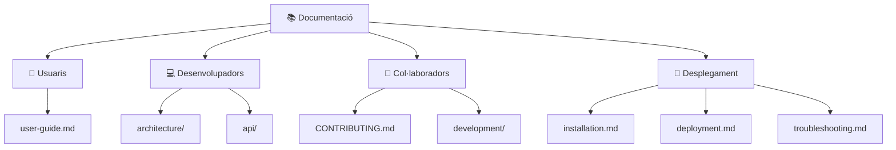

# 📚 Índex de la Documentació · Botiga en Línia

Aquesta és la porta d'entrada a la documentació del projecte. S'organitza per a **quatre públics**, seguint les recomanacions de documentació de programari de Google i *source{d}*.

> [!TIP]
> Tota la documentació és Markdown dins del mateix repositori. Els diagrames són **Mermaid** i GitHub els dibuixa automàticament. Es revisa i es versiona igual que el codi: cada canvi passa per una *pull request*.

---

## 🎯 Tria el teu camí



---

### 👤 Usuaris
*Volen saber què fa l'aplicació i com s'utilitza.*

| Document | Contingut |
| :--- | :--- |
| 📖 [Manual d'usuari](user-guide.md) | Casos d'ús i ús pas a pas de cada pantalla: clients, catàleg, vendes, desar i eixir. |

### 💻 Desenvolupadors
*Volen entendre el codi i els seus mètodes.*

| Document | Contingut |
| :--- | :--- |
| 🏛️ [Arquitectura i tecnologies](architecture/overview.md) | Organització de `Main.java`, responsabilitats de cada part, tecnologies i restriccions didàctiques. |
| 🗄️ [Model de dades](architecture/data-model.md) | Vectors paral·lels, relacions entre entitats, regles de les dades i format del fitxer. |
| 📊 [Diagrames](architecture/diagrams.md) | Arquitectura, casos d'ús, model de dades, navegació i flux d'una venda. |
| 📚 [Referència de mètodes](api/README.md) | Índex dels mètodes de `Main.java` agrupats per mòdul. |

### 👥 Col·laboradors
*Volen saber com treballar amb l'equip.*

| Document | Contingut |
| :--- | :--- |
| 🤝 [Guia de contribució](../CONTRIBUTING.md) | Normes del codi, branques, *commits*, *pull requests*, revisió i documentació obligatòria. |
| ⚙️ [Flux de treball](development/workflow.md) | Cicle d'una tasca amb Kanban, branques i *pull requests*, i com resoldre conflictes. |
| 🧪 [Proves](development/testing.md) | Proves amb canonades (`printf ... \|`) i casos de prova manuals. |
| 💻 [Entorn de desenvolupament](development/environment.md) | JDK, editor i terminal recomanats. |
| 📝 [Plantilla de pull request](../.github/PULL_REQUEST_TEMPLATE.md) · 🐛 [Plantilles d'incidències](../.github/ISSUE_TEMPLATE/) | Formularis per a proposar canvis i comunicar [errors](../.github/ISSUE_TEMPLATE/bug.md) o [millores](../.github/ISSUE_TEMPLATE/improvement.md). |

### 🚀 Desplegament
*Volen instal·lar, executar i mantindre l'aplicació.*

| Document | Contingut |
| :--- | :--- |
| 🛠️ [Instal·lació](installation.md) | Requisits i primera execució en Linux, Windows i macOS. |
| 🚢 [Desplegament i manteniment](deployment.md) | Execució a l'aula, fitxer de dades, còpies de seguretat i actualització. |
| 🔧 [Resolució de problemes](troubleshooting.md) | Errors freqüents i com solucionar-los. |

---

## 🗺️ Mapa de fitxers

```text
docs/
├── README.md               # Aquest índex
├── user-guide.md           # Manual d'usuari i casos d'ús
├── installation.md         # Requisits i instal·lació
├── deployment.md           # Execució, dades i manteniment
├── troubleshooting.md      # Problemes freqüents
│
├── architecture/
│   ├── overview.md         # Arquitectura, tecnologies i restriccions didàctiques
│   ├── data-model.md       # Model de dades i format del fitxer
│   └── diagrams.md         # Tots els diagrames Mermaid
│
├── api/
│   ├── README.md           # Índex de mètodes
│   ├── ui.md               # Mètodes d'interfície (els únics amb colors)
│   ├── customers.md        # Mòdul de clients
│   ├── products.md         # Mòdul de productes i estoc
│   ├── sales.md            # Mòdul de vendes i tiquet
│   └── data.md             # Cerca per ID, alta als vectors i persistència
│
└── development/
    ├── environment.md      # Entorn de treball
    ├── testing.md          # Proves
    └── workflow.md         # Flux de treball amb Git i GitHub
```
