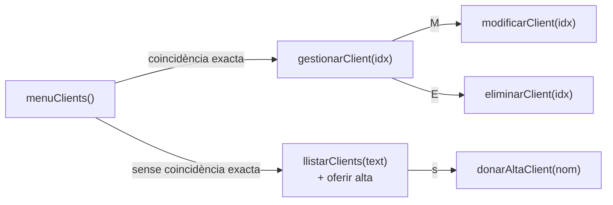

# 👥 Mòdul de Clients

Mètodes que gestionen el directori de clients. El mòdul **no té submenú**: en entrar es mostra el directori, i l'alta, la modificació i la baixa es fan a partir de la cerca.

---

## `void menuClients()`

Bucle principal del mòdul.

1. Mostra la capçalera, el directori complet amb `llistarClients("")` i el total de clients.
2. Llig el text de cerca. Si és **buit**, torna al menú principal.
3. Busca una **coincidència exacta** amb algun camp de cada client:
   - el nom o el correu, sense distingir majúscules (`equalsIgnoreCase`);
   - el telèfon (`equals`);
   - l'ID, escrit com `101` o com `#101`.
4. Segons el resultat:
   - **Si hi ha coincidència**, crida `gestionarClient(idx)`.
   - **Si no n'hi ha**, mostra les coincidències parcials amb `llistarClients(entrada)`, avisa i pregunta `[s/N]` si es vol donar d'alta un client amb aquest nom. Amb `s`, crida `donarAltaClient(entrada)`.

**Dades:** llig `clientIds`, `clientNoms`, `clientEmails`, `clientTelefons` i `clientCount`.

---

## `void llistarClients(String filtre)`

Mostra en una taula els clients que contenen el text `filtre` en algun camp.

| Paràmetre | Descripció |
| :--- | :--- |
| `filtre` | Text a buscar, sense distingir majúscules. Amb `""` es mostren tots els clients. |

- Per a cada client, ajunta en un sol text l'ID amb `#`, el nom, el correu i el telèfon, i mira si conté el filtre.
- Columnes de la taula: `ID`, `NOM DEL CLIENT`, `CORREU ELECTRÒNIC`, `TELÈFON` i `ESTAT` (amb `BADGE_ACTIU` o `BADGE_BAIXA`).
- Si cap client coincideix, `mostrarTaula` mostra *(No hi ha cap registre per mostrar)*.

També el fa servir `registrarVenda()` per a mostrar els clients abans de demanar l'ID.

---

## `void gestionarClient(int idx)`

Fitxa del client que hi ha a la posició `idx`.

1. Mostra les dades amb `dada(...)`: ID, nom, correu, telèfon i estat.
2. Mostra el seu historial de compres amb `llistarVendes(clientIds[idx], -1, "")`.
3. Llig l'acció:

| Acció | Mètode |
| :--- | :--- |
| `M` | `modificarClient(idx)` |
| `E` | `eliminarClient(idx)` |
| `INTRO` | Torna al directori. |
| Una altra | Avís *Acció no reconeguda* i torna al directori. |

---

## `void modificarClient(int idx)`

Demana un valor nou per a cada camp. `INTRO` sense escriure res manté el valor actual.

| Camp | Validació | Si no és vàlid |
| :--- | :--- | :--- |
| Nom | Almenys 3 caràcters | `error(...)` i es manté l'anterior |
| Correu | Conté `@` i `.`. Es guarda en minúscules | `error(...)` i es manté l'anterior |
| Telèfon | Cap | — |

En acabar mostra `ok(...)`.

**Dades:** modifica `clientNoms[idx]`, `clientEmails[idx]` i `clientTelefons[idx]`.

---

## `void eliminarClient(int idx)`

Dona de baixa el client, després de demanar confirmació `[s/N]`.

- **Amb `s`:** posa `clientActius[idx] = false` i mostra `ok(...)`.
- **Amb qualsevol altra resposta:** avís *Operació cancel·lada*.

> [!NOTE]
> És una **baixa lògica**: el client no s'esborra dels vectors, i el seu historial de vendes continua sent coherent.

---

## `void donarAltaClient(String nom)`

Registra un client nou.

| Paràmetre | Descripció |
| :--- | :--- |
| `nom` | Nom proposat: el text que s'havia cercat. L'usuari el pot acceptar amb `INTRO` o escriure'n un altre. |

1. Si ja hi ha `maxClients` (50) clients, mostra un error i acaba.
2. Demana el nom. Si té menys de 3 caràcters, mostra un error i acaba.
3. Demana el correu. Si no conté `@` i `.`, mostra un error i acaba.
4. Demana el telèfon.
5. Crida `afegirClient(101 + clientCount, nom, email, telefon, true)` i mostra el nou identificador.

**Dades:** afegeix un registre al final dels vectors de clients i incrementa `clientCount`.
