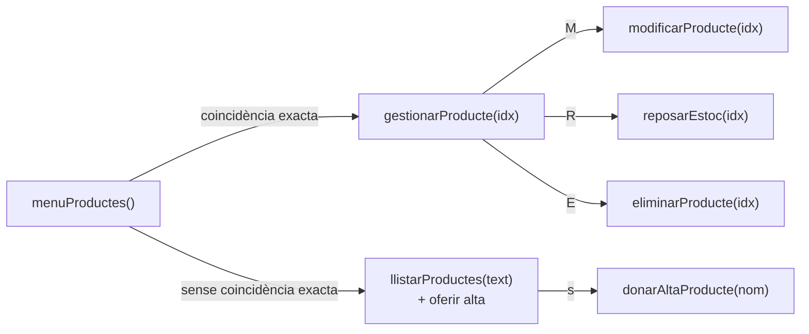

# 📦 Mòdul de Productes i Estoc

Mètodes que gestionen el catàleg d'articles i el seu estoc. Igual que el de clients, el mòdul **no té submenú**: es mostra el catàleg, i totes les accions es fan a partir de la cerca.



---

## `void menuProductes()`

Bucle principal del mòdul.

1. Mostra la capçalera, el catàleg complet amb `llistarProductes("")` i el total d'articles.
2. Llig el text de cerca. Si és **buit**, torna al menú principal.
3. Busca una **coincidència exacta** amb:
   - el nom, sense distingir majúscules;
   - l'ID escrit de qualsevol d'aquestes maneres: `1`, `#1` o `01`.
4. Segons el resultat:
   - **Si hi ha coincidència**, crida `gestionarProducte(idx)`.
   - **Si no n'hi ha**, mostra les coincidències parcials amb `llistarProductes(entrada)`, avisa i pregunta `[s/N]` si es vol donar d'alta un article amb aquest nom.

---

## `void llistarProductes(String filtre)`

Mostra en una taula els articles que contenen el text `filtre` en l'ID, el nom o la categoria.

| Paràmetre | Descripció |
| :--- | :--- |
| `filtre` | Text a buscar, sense distingir majúscules. Amb `""` es mostren tots els articles. |

| Columna | Contingut |
| :--- | :--- |
| `ID` | Identificador amb dues xifres (`01`). |
| `NOM PRODUCTE` | Nom de l'article. |
| `CATEGORIA` | Categoria de l'article. |
| `PREU UNIT.` | Preu amb dos decimals i `€`. |
| `NIVELL D'ESTOC` | Barra de 10 caselles i el nombre d'unitats (vegeu més avall). |
| `DISPONIBILITAT` | `BADGE_EN_ESTOC` (més de 10 unitats), `BADGE_BAIX` (d'1 a 10) o `BADGE_ESGOTAT` (0). |

**Càlcul de la barra d'estoc:**

```java
int plens = Math.min(10, estoc / 3);   // 3 unitats per casella; amb 30 unitats és plena
String colorBarra = estoc == 0 ? RED : estoc < 10 ? YLW : GRN;
String barra = colorBarra + "[" + "█".repeat(plens) + "░".repeat(10 - plens) + "]" + RST;
```

També el fa servir `registrarVenda()` per a mostrar el catàleg abans de demanar l'ID de l'article.

---

## `void gestionarProducte(int idx)`

Fitxa de l'article que hi ha a la posició `idx`.

1. Mostra les dades amb `dada(...)`: ID, nom, categoria, preu i estoc.
2. Mostra el seu historial de vendes amb `llistarVendes(-1, producteIds[idx], "")`.
3. Llig l'acció:

| Acció | Mètode |
| :--- | :--- |
| `M` | `modificarProducte(idx)` |
| `R` | `reposarEstoc(idx)` |
| `E` | `eliminarProducte(idx)` |
| `INTRO` | Torna al catàleg. |
| Una altra | Avís *Acció no reconeguda* i torna al catàleg. |

---

## `void modificarProducte(int idx)`

Demana un valor nou per a cada camp. `INTRO` sense escriure res manté el valor actual.

| Camp | Validació | Si no és vàlid |
| :--- | :--- | :--- |
| Nom | Almenys 2 caràcters | `error(...)` i es manté l'anterior |
| Categoria | Cap | — |
| Preu | Número més gran que 0 | `error(...)` i es manté l'anterior |
| Estoc | Enter igual o més gran que 0 | `error(...)` i es manté l'anterior |

> [!NOTE]
> El preu i l'estoc són dins del mateix `try`. Si el preu no és un número, es mostra *Format numèric invàlid* i ja no es pregunta l'estoc.

**Dades:** modifica `producteNoms[idx]`, `producteCategories[idx]`, `productePreus[idx]` i `producteEstoc[idx]`.

---

## `void reposarEstoc(int idx)`

Demana quantes unitats s'afegeixen, mostrant l'estoc actual a l'enunciat.

- **Amb un enter més gran que 0:** el suma a `producteEstoc[idx]` i mostra el nou estoc.
- **Amb un número ≤ 0:** `error(...)`.
- **Amb text no numèric:** `error("Format numèric invàlid.")`.

---

## `void eliminarProducte(int idx)`

Elimina l'article del catàleg.

1. Compta quantes vendes té l'article. Si en té alguna, ho avisa.
2. Demana confirmació `[s/N]`. Sense `s`, cancel·la.
3. Mostra `ok(...)` i **desplaça una posició cap a l'esquerra** tots els articles que hi ha darrere, en els cinc vectors.
4. Decrementa `producteCount`.

> [!NOTE]
> És una **eliminació física**. Les vendes antigues conserven l'ID de l'article. Com que ja no el troben, a l'historial mostren `#ID` en lloc del nom.

---

## `void donarAltaProducte(String nom)`

Registra un article nou.

| Paràmetre | Descripció |
| :--- | :--- |
| `nom` | Nom proposat: el text que s'havia cercat. L'usuari el pot acceptar amb `INTRO` o escriure'n un altre. |

1. Si ja hi ha `maxProductes` (50) articles, mostra un error i acaba.
2. Demana el nom. Si té menys de 2 caràcters, mostra un error i acaba.
3. Demana la categoria. Si es deixa buida, val `"General"`.
4. Demana el preu. Si és ≤ 0, mostra un error i acaba.
5. Demana l'estoc. Si és < 0, mostra un error i acaba.
6. Calcula el nou ID com el més alt dels existents + 1, i crida `afegirProducte(...)`.

Si el preu o l'estoc no són números, mostra `error("Format numèric invàlid.")` i no crea l'article.

**Dades:** afegeix un registre al final dels vectors de productes i incrementa `producteCount`.
