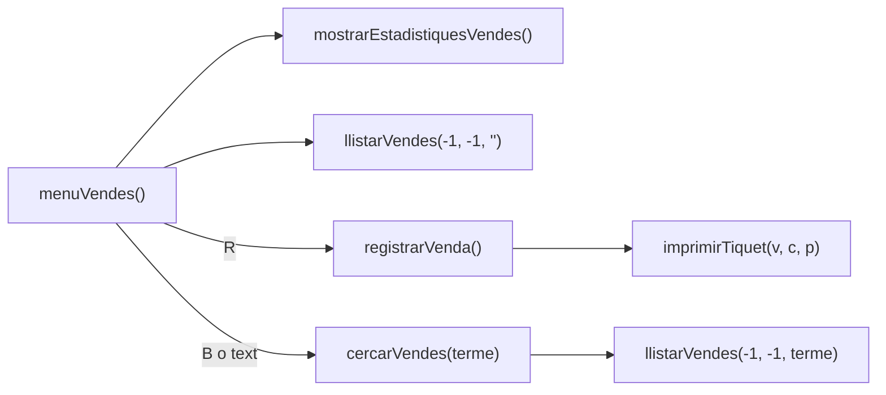

# 💳 Mòdul de Vendes

Mètodes de les estadístiques, l'historial, la cerca i el registre de vendes, i el tiquet. El total d'una venda és sempre **preu unitari × unitats**: no hi ha descomptes.



---

## `void menuVendes()`

Bucle principal del mòdul.

1. Mostra la capçalera, les estadístiques amb `mostrarEstadistiquesVendes()` i l'historial complet amb `llistarVendes(-1, -1, "")`.
2. Llig l'acció:

| Entrada | Acció |
| :--- | :--- |
| `INTRO` | Torna al menú principal. |
| `R` | `registrarVenda()` |
| `B` | Demana el text a cercar i crida `cercarVendes(terme)`. |
| Qualsevol altre text | `cercarVendes(text)`: el text es fa servir directament com a cerca. |

---

## `void mostrarEstadistiquesVendes()`

Si no hi ha cap venda, mostra l'avís *Encara no hi ha cap venda registrada* i acaba. Si n'hi ha, recorre `vendaTotals` i mostra quatre targetes amb `mostrarTargetes`:

| Targeta | Càlcul |
| :--- | :--- |
| 💳 Total facturat | Suma de tots els `vendaTotals[i]`. |
| 📈 Mitjana/venda | `suma / vendaCount` |
| 🏆 Venda màxima | `Math.max` sobre tots els totals. |
| 📉 Venda mínima | `Math.min` sobre tots els totals. |

---

## `void llistarVendes(int clientId, int producteId, String filtre)`

Mostra en una taula les vendes que compleixen **els tres filtres alhora**, i a sota un resum (*N comandes · U unitats · Facturació: X €*).

| Paràmetre | Descripció |
| :--- | :--- |
| `clientId` | Només les vendes d'aquest client. Amb `-1`, de qualsevol client. |
| `producteId` | Només les vendes d'aquest producte. Amb `-1`, de qualsevol producte. |
| `filtre` | Text que ha d'aparéixer en l'ID de venda, l'ID o el nom del client, l'ID o el nom de l'article o la data. Amb `""`, qualsevol. |

Exemples d'ús al codi:

| Crida | On |
| :--- | :--- |
| `llistarVendes(-1, -1, "")` | Historial complet (`menuVendes`) |
| `llistarVendes(-1, -1, terme)` | Resultats d'una cerca (`cercarVendes`) |
| `llistarVendes(clientIds[idx], -1, "")` | Historial d'un client (`gestionarClient`) |
| `llistarVendes(-1, producteIds[idx], "")` | Historial d'un article (`gestionarProducte`) |

Columnes de la taula: `ID VENDA`, `CLIENT`, `ARTICLE`, `QUANTITAT`, `DATA` i `TOTAL LIQ.`. El nom del client i el de l'article es busquen amb `cercarIndexClientPerId` i `cercarIndexProductePerId`. Si ja no existeixen, es mostra `#ID`.

---

## `void cercarVendes(String terme)`

Si `terme` és buit, no fa res. Si no ho és:
1. Mostra el títol *RESULTATS DE LA CERCA DE VENDES*.
2. Mostra la taula amb `llistarVendes(-1, -1, terme)`.
3. Espera que l'usuari prema `INTRO` per a tornar.

---

## `void registrarVenda()`

Registra una comanda d'un client per a un article.

1. Si ja hi ha `maxVendes` (50) vendes, mostra un error i acaba.
2. Mostra els clients i demana l'**ID del client**. Si no existeix, *Client #ID inexistent*.
3. Mostra el catàleg i demana l'**ID del producte**. Si no existeix, *Producte #ID no trobat*.
4. Demana les **unitats**. Si són menys d'1, o més que l'estoc disponible, mostra l'error corresponent.
5. Resta les unitats de `producteEstoc[p]`.
6. Crida `afegirVenda(1001 + vendaCount, clientIds[c], producteIds[p], quantitat, productePreus[p] * quantitat, "2026-10-22")`.
7. Imprimeix el tiquet amb `imprimirTiquet(vendaCount - 1, c, p)` i una nota amb l'estoc restant.

> [!WARNING]
> En aquest mètode els números es converteixen amb `Integer.parseInt` **sense** `try/catch`. Si s'escriu text en lloc d'un ID o d'una quantitat, l'aplicació s'atura amb `NumberFormatException`. És una limitació coneguda de la demo.

> [!NOTE]
> No es comprova si el client està de baixa: també se li poden registrar vendes. La data de les vendes noves és fixa.

**Dades:** modifica `producteEstoc[p]` i afegeix un registre als vectors de vendes.

---

## `void imprimirTiquet(int v, int c, int p)`

Imprimeix el tiquet d'una venda. Ho fa **tot directament** amb `println`, sense cridar cap altre mètode del programa.

| Paràmetre | Descripció |
| :--- | :--- |
| `v` | Posició de la venda als vectors de vendes. |
| `c` | Posició del client als vectors de clients. |
| `p` | Posició del producte als vectors de productes. |

- **Codi de transacció:** `TIQ-<idVenda>-<número aleatori de 1000 a 9999>`, amb `random.nextInt(9000) + 1000`.
- **Línies d'etiqueta i valor:** s'alineen amb un únic patró de format: l'etiqueta ocupa 30 caràcters a l'esquerra i el valor 32 a la dreta.

```java
String linia = WHT + BLD + "│  " + RST + CYN + "%-30s" + WHT + BLD + "%32s  │" + RST;
println(linia.formatted("Client comprador:", clientNoms[c] + " (ID #" + clientIds[c] + ")"));
```

Contingut del tiquet: identificador de venda, codi de transacció, data, client, article, preu unitari, quantitat i total liquidat.
