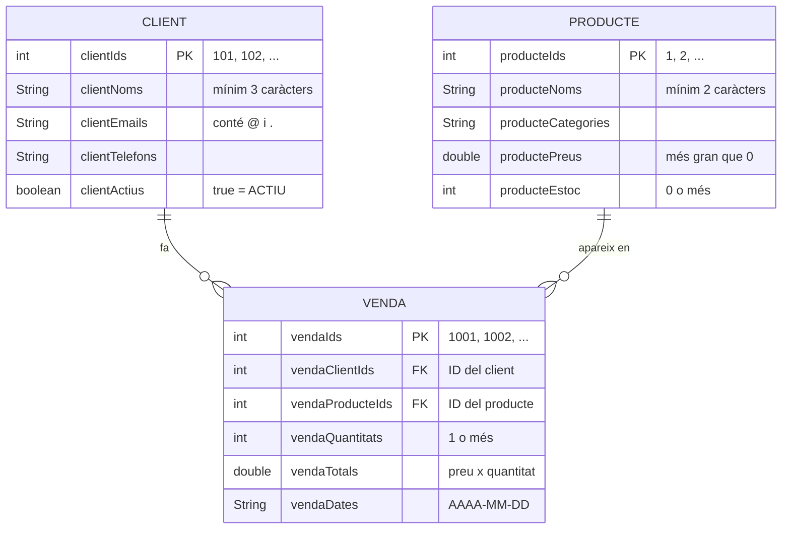

# 🗄️ Model de Dades · Botiga en Línia

Aquest document descriu les dades de l'aplicació: les entitats, els seus atributs, com es relacionen, les regles que compleixen i com es guarden al fitxer.

> [!IMPORTANT]
> No hi ha classes ni base de dades externa. Cada entitat és un grup de **vectors paral·lels**: un vector per atribut, i totes les dades d'un mateix registre són a la **mateixa posició** `i` de cada vector.

---

## 📊 Diagrama entitat-relació



- Un **client** pot fer **cap o moltes** vendes.
- Un **producte** pot aparéixer en **cap o moltes** vendes.
- Cada **venda** és d'**un sol client** i d'**un sol producte**, amb una quantitat d'unitats.

---

## 🧱 Com funcionen els vectors paral·lels

Exemple amb les dades de demostració dels clients:

| Posició `i` | `clientIds[i]` | `clientNoms[i]` | `clientEmails[i]` | `clientTelefons[i]` | `clientActius[i]` |
| :---: | :--- | :--- | :--- | :--- | :--- |
| 0 | `101` | `"Anna Garcia"` | `"anna@correu.cat"` | `"611223344"` | `true` |
| 1 | `102` | `"Bernat Lopez"` | `"bernat@correu.cat"` | `"622334455"` | `true` |
| 2 | `103` | `"Carla Vidal"` | `"carla@correu.cat"` | `"633445566"` | `true` |
| 3 | `104` | `"David Mas"` | `"david@correu.cat"` | `"644556677"` | `true` |

Cada entitat té:
- **Un límit** (`maxClients`, `maxProductes`, `maxVendes`), que és 50 en els tres casos i fixa la mida dels vectors.
- **Un comptador** (`clientCount`, `producteCount`, `vendaCount`) amb el nombre de posicions ocupades. Els registres van de la posició `0` a la `comptador - 1`.

Els registres nous sempre s'afegeixen al final, amb `afegirClient`, `afegirProducte` i `afegirVenda` ([api/data.md](../api/data.md)).

---

## 📋 Entitats

### 👥 Client

| Atribut | Tipus | Regles |
| :--- | :--- | :--- |
| `clientIds[i]` | `int` | Clau primària. En una alta val `101 + clientCount`. |
| `clientNoms[i]` | `String` | Obligatori, mínim 3 caràcters. |
| `clientEmails[i]` | `String` | Ha de contindre `@` i `.`. Es guarda en minúscules. |
| `clientTelefons[i]` | `String` | Text lliure. |
| `clientActius[i]` | `boolean` | `true` en l'alta. Passa a `false` quan es dona de baixa. |

> [!NOTE]
> La baixa és **lògica**: el client no s'esborra dels vectors, només canvia `clientActius[i]` a `false`. Així les seues vendes continuen apuntant a un client existent.

### 📦 Producte

| Atribut | Tipus | Regles |
| :--- | :--- | :--- |
| `producteIds[i]` | `int` | Clau primària. En una alta val l'ID més alt existent + 1. Es mostra amb dues xifres (`01`). |
| `producteNoms[i]` | `String` | Obligatori, mínim 2 caràcters. |
| `producteCategories[i]` | `String` | Text lliure. Si es deixa buit en l'alta, val `"General"`. |
| `productePreus[i]` | `double` | Preu unitari en euros, més gran que 0. |
| `producteEstoc[i]` | `int` | Unitats disponibles, mai negatives. |

> [!NOTE]
> L'eliminació d'un producte és **física**: tots els productes que hi ha darrere es desplacen una posició cap a l'esquerra i `producteCount` baixa en 1. Les vendes antigues conserven l'ID del producte. Com que ja no es troba, a l'historial es mostra `#ID` en lloc del nom.

### 💳 Venda

| Atribut | Tipus | Regles |
| :--- | :--- | :--- |
| `vendaIds[i]` | `int` | Clau primària. En una venda nova val `1001 + vendaCount`. |
| `vendaClientIds[i]` | `int` | Clau forana: ha d'existir a `clientIds` en el moment de la venda. |
| `vendaProducteIds[i]` | `int` | Clau forana: ha d'existir a `producteIds` en el moment de la venda. |
| `vendaQuantitats[i]` | `int` | Entre 1 i l'estoc disponible del producte. |
| `vendaTotals[i]` | `double` | `productePreus[p] * quantitat`. No hi ha descomptes. |
| `vendaDates[i]` | `String` | Format `AAAA-MM-DD`. Les vendes noves es guarden amb la data fixa `2026-10-22`. |

En registrar una venda, l'estoc del producte es redueix en la quantitat venuda.

---

## 🔗 Com es resolen les relacions

Les claus foranes es resolen amb una **cerca per ID**, que retorna la posició dins dels vectors (o `-1` si no existeix):

```java
int c = cercarIndexClientPerId(vendaClientIds[i]);     // posició del client
int p = cercarIndexProductePerId(vendaProducteIds[i]); // posició del producte
String client = c != -1 ? clientNoms[c] : "#" + vendaClientIds[i];
```

---

## 💾 Format del fitxer `dades_botiga.txt`

El fitxer és text pla. Té tres **seccions** marcades entre claudàtors, i a cada línia hi ha un registre amb els camps separats per **punt i coma**, en el mateix ordre que els vectors:

```text
# DADES DE LA BOTIGA EN LINIA
[CLIENTS]
101;Anna Garcia;anna@correu.cat;611223344;true
102;Bernat Lopez;bernat@correu.cat;622334455;true
103;Carla Vidal;carla@correu.cat;633445566;true
104;David Mas;david@correu.cat;644556677;true
[PRODUCTES]
1;Portatil 15 polzades;Ordinadors;749.99;10
2;Ratoli sense fils;Accessoris;19.95;25
3;Teclat mecanic;Accessoris;49.5;15
4;Monitor 24 4K;Monitors;189.0;8
5;Auriculars Bluetooth;Audio;39.9;30
[VENDES]
1001;101;1;1;749.99;2026-10-15
1002;103;3;1;49.5;2026-10-20
```

| Secció | Camps de cada línia |
| :--- | :--- |
| `[CLIENTS]` | `id;nom;correu;telèfon;actiu` |
| `[PRODUCTES]` | `id;nom;categoria;preu;estoc` |
| `[VENDES]` | `id;idClient;idProducte;quantitat;total;data` |

### Regles de lectura i escriptura
1. **Ruta:** `projecte/dades_botiga.txt`, relativa al directori des d'on s'executa Java. Per això cal executar des de l'arrel del repositori.
2. **En arrancar:**
   - Primer es carreguen les dades de demostració.
   - Després es llig el fitxer.
   - Cada secció trobada **substitueix** la de demostració.
   - Les línies buides i les que comencen per `#` s'ignoren.
   - Si el fitxer no existeix o té un error de format, es manté el que s'haja pogut carregar, sense cap avís.
3. **En desar (opció 4):** el fitxer es **reescriu sencer** amb l'estat actual dels vectors.
4. **Separadors:** els decimals es guarden amb punt (`749.99`). Cap camp pot contindre `;`, perquè trencaria la línia.
