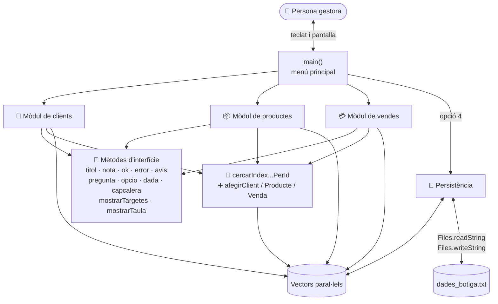
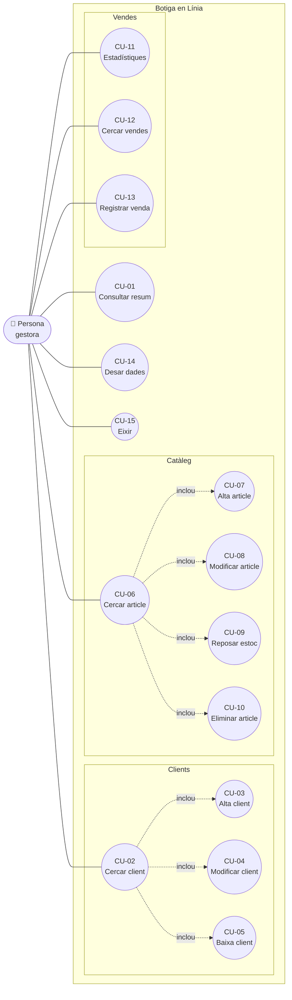
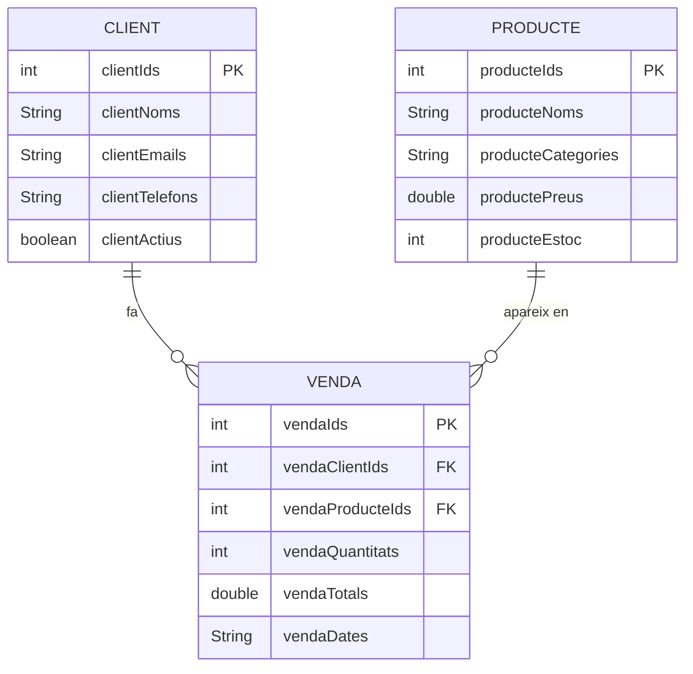
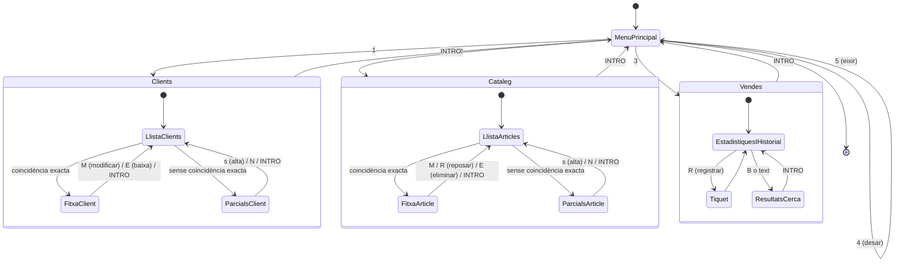
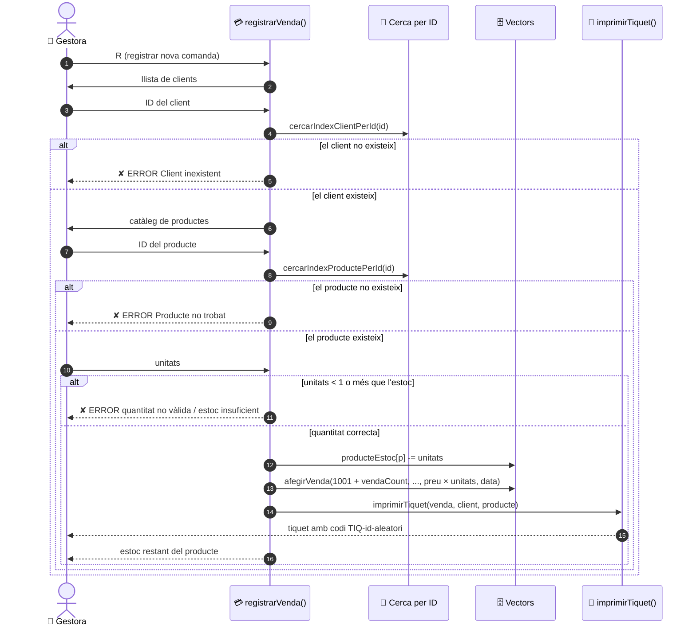

# 📊 Diagrames · Botiga en Línia

Tots els diagrames estan escrits en **Mermaid** dins d'aquest fitxer Markdown (*documentació com a codi*). GitHub els dibuixa automàticament i es poden revisar en una *pull request* com qualsevol línia de codi.

## 📑 Índex

1. [Arquitectura](#1-arquitectura)
2. [Casos d'ús](#2-casos-dús)
3. [Model de dades](#3-model-de-dades)
4. [Navegació entre pantalles](#4-navegació-entre-pantalles)
5. [Flux d'una venda](#5-flux-duna-venda)

---

## 1. Arquitectura

Parts de `Main.java` i com depenen les unes de les altres. L'explicació és a [overview.md](overview.md).

---

## 2. Casos d'ús

L'especificació de cada cas d'ús és al [manual d'usuari](../user-guide.md#casos-dús).

> [!NOTE]
> Les fletxes discontínues indiquen que l'alta, la modificació, la baixa, la reposició i l'eliminació **es fan des de la cerca**: no hi ha cap menú propi per a fer-les.

---

## 3. Model de dades

Entitats, atributs i relacions. Les regles de cada atribut són a [data-model.md](data-model.md).

---

## 4. Navegació entre pantalles

Què passa amb cada tecla. `INTRO` buit sempre torna a la pantalla anterior.

---

## 5. Flux d'una venda

Seqüència completa de `registrarVenda()`, des que es tria `R` fins que s'imprimeix el tiquet.

