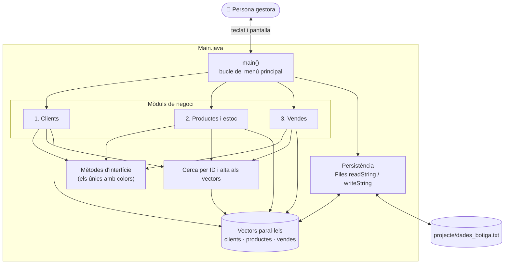

# 🏛️ Arquitectura i Tecnologies · Botiga en Línia

Aquest document explica com està organitzat el codi, quines responsabilitats té cada part, per què està fet així i amb quines tecnologies.

---

## 🧭 Visió general

Tota l'aplicació és un **únic fitxer**, [`Main.java`](../../Main.java), escrit com a *classe implícita* de Java 25. Dins del fitxer, el codi s'organitza en **seccions** separades per comentaris. Cada secció té una única responsabilitat:

---

## 🧩 Seccions de `Main.java`

Les seccions apareixen en aquest ordre dins del fitxer:

| Secció | Contingut | Referència |
| :--- | :--- | :--- |
| **Capçalera i GUIDELINES** | Directiva de JBang, descripció i les restriccions del llenguatge que ha de complir el codi. | [Restriccions](#restriccions-del-llenguatge) |
| **Paleta de colors ANSI** | Constants curtes (`RST`, `BLD`, `CYN`, `GRN`...) i les etiquetes d'estat (`BADGE_ACTIU`, `BADGE_ESGOTAT`...). | [api/ui.md](../api/ui.md) |
| **Estructures de dades** | Vectors paral·lels de clients, productes i vendes, amb els seus comptadors i límits. | [data-model.md](data-model.md) |
| **Objectes globals** | `scanner`, `random` i la ruta del fitxer de dades. | — |
| **Mètode principal** | `main()`, la capçalera amb el logotip, el resum general i el menú principal. | [api/ui.md](../api/ui.md) |
| **Mètodes d'interfície** | `titol`, `nota`, `ok`, `error`, `avis`, `pregunta`, `opcio`, `dada`, `capcalera`, `mostrarTargetes` i `mostrarTaula`. | [api/ui.md](../api/ui.md) |
| **1. Mòdul de clients** | Directori, cerca, fitxa, modificació, baixa i alta. | [api/customers.md](../api/customers.md) |
| **2. Mòdul de productes i estoc** | Catàleg, cerca, fitxa, modificació, reposició, eliminació i alta. | [api/products.md](../api/products.md) |
| **3. Mòdul de vendes** | Estadístiques, historial, cerca, registre i tiquet. | [api/sales.md](../api/sales.md) |
| **Cerca per identificador** | `cercarIndexClientPerId` i `cercarIndexProductePerId`. | [api/data.md](../api/data.md) |
| **Alta als vectors** | `afegirClient`, `afegirProducte` i `afegirVenda`. | [api/data.md](../api/data.md) |
| **Persistència** | `guardarDadesFitxer` i `carregarDadesFitxer`. | [api/data.md](../api/data.md) |
| **Dades de demostració** | `inicialitzarDadesBase`: 4 clients, 5 productes i 2 vendes. | [api/data.md](../api/data.md) |

---

## 🔄 Cicle de vida d'una execució

1. `inicialitzarDadesBase()` omple els vectors amb les dades de demostració.
2. `carregarDadesFitxer()` llig `projecte/dades_botiga.txt`. Cada secció que hi trobe substitueix la de demostració. Si el fitxer no existeix, no passa res.
3. Es mostra el logotip i comença el bucle del menú principal: resum general, menú i opció.
4. Cada mòdul té el seu propi bucle. Es queda a la seua pantalla fins que l'usuari prem `INTRO` sense escriure res.
5. L'opció `4` escriu el fitxer. L'opció `5` acaba el mètode `main()`.

La navegació completa entre pantalles és a [diagrams.md](diagrams.md#4-navegació-entre-pantalles).

---

## 🏗️ Decisions de disseny

Totes les decisions busquen que l'alumnat de 1r, que encara no sap programar, puga llegir el codi i reconéixer-hi coses.

| Decisió | Motiu |
| :--- | :--- |
| **Tot en un fitxer, sense classes pròpies** | No cal saber què és una classe ni un objecte per a seguir el programa. |
| **Vectors paral·lels en lloc d'objectes** | Cada dada d'una entitat és en un vector diferent, a la mateixa posició. Es pot "veure" un registre llegint la posició `i` de cada vector. |
| **Els colors només dins dels mètodes d'interfície** | Els mòduls de negoci criden `titol(...)`, `error(...)`, `pregunta(...)`... i el text queda net, sense codis ANSI pel mig. Els badges de les taules són constants amb nom. |
| **`pregunta` i `opcio` només imprimeixen** | La resposta es llig just a continuació, en una variable local amb nom descriptiu: `String email = scanner.nextLine().trim();`. Així es veu clarament d'on ve cada dada. |
| **`mostrarTaula` i `imprimirTiquet` imprimeixen directament** | Tot el dibuix és dins del mateix mètode, amb `print` i `println`, sense mètodes auxiliars ni variables intermèdies. |
| **Un mètode de llistat per entitat, amb filtre** | `llistarClients(filtre)`, `llistarProductes(filtre)` i `llistarVendes(clientId, producteId, filtre)` serveixen per a la llista completa (`""`), per a les coincidències parcials i per als historials. |
| **Sense submenús** | Cada mòdul mostra directament les dades i, a sota, les accions. L'usuari fa menys passos. |
| **Mètodes sense valor de retorn** | Tots els mètodes són `void`, excepte els dos que busquen per ID (`int`). Les regles del curs ho exigeixen. |
| **Gestió d'errors mínima** | Només hi ha `try/catch (Exception e)` on cal llegir números en formularis de productes i en carregar el fitxer. |

---

## Tecnologies i restriccions didàctiques

### Tecnologies

| Tecnologia | Ús al projecte |
| :--- | :--- |
| **Java 25 (OpenJDK)** | Llenguatge de l'aplicació. Es fan servir les *classes implícites* i els mètodes `main` d'instància (JEP 512, definitius des de Java 25): el fitxer no declara `class` i comença amb `void main()`. |
| **`java.lang.IO`** | `print` i `println` sense `System.out`, gràcies a `import static java.lang.IO.*;`. També és definitiva des de Java 25. |
| **Codis d'escapament ANSI** | Colors i negreta a la terminal (`"\u001B[96m"`...) sense cap llibreria externa. |
| **Caràcters Unicode de caixa** | Vores de taules, targetes i tiquet (`╭ ─ ╮ │ ├ ┼ ┤ ╰ ╯`) i barres d'estoc (`█ ░`). |
| **`java.nio.file.Files`** | Persistència amb només dues crides: `Files.readString` i `Files.writeString`. |
| **`java.util.Scanner`** | Lectura del teclat línia a línia (`nextLine`). |
| **`java.util.Random`** | Número aleatori del codi de transacció del tiquet. |
| **Markdown + Mermaid** | Documentació i diagrames versionats al repositori, que GitHub dibuixa automàticament. |
| **Git i GitHub** | Control de versions, incidències, Kanban i *pull requests*. És l'objectiu real del projecte. |
| **JBang** *(opcional)* | Permet executar `Main.java` com un script gràcies a la primera línia del fitxer. |

### Restriccions del llenguatge

El codi segueix les **GUIDELINES** escrites al principi de `Main.java`:

- **Sense classes pròpies:** tot és a `Main.java`, com a classe implícita.
- **Mètodes:** poden rebre paràmetres, però no retornen res. L'única excepció són els mètodes `int` que busquen un element per ID.
- **Tipus:** `int`, `boolean`, `double`, `char` i `String`.
- **Conversions:** `Integer.parseInt`, `Double.parseDouble` i `Boolean.parseBoolean`.
- **Operadors:** aritmètics, mòdul (`%`), relacionals, lògics i ternari (`? :`).
- **Control de flux:** `if/else`, `switch` amb fletxa (`case "M" -> ...`), `for`, `while`.
- **Estructures:** vectors (`int[]`, `String[]`...) i matrius (`String[][]`).
- **Biblioteca:**
  - `Math`: `max` i `min`.
  - `Random`: `nextInt`.
  - `Scanner`: `nextLine`.
  - `String`: `length`, `trim`, `toLowerCase`, `toUpperCase`, `contains`, `startsWith`, `equals`, `equalsIgnoreCase`, `isEmpty`, `split`, `repeat` i `formatted`.
- **Errors:** la mínima gestió possible, i només amb la classe `Exception`.
- **Fitxers:** només `Files.writeString` i `Files.readString`, sense cap altra gestió de fitxers.

> [!NOTE]
> **Única excepció:** `mostrarTaula` fa servir `replaceAll` amb una expressió regular per a no comptar els codis de color dels badges en calcular l'amplada d'una cel·la. És una sola línia, amb un comentari que l'explica.
