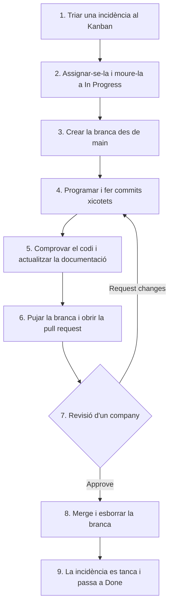

# ⚙️ Flux de Treball amb Git i GitHub

El cicle que ha de seguir cada membre de l'equip per a completar les **16 tasques** del projecte amb incidències, tauler Kanban, branques i *pull requests*. Les normes completes són a [CONTRIBUTING.md](../../CONTRIBUTING.md).

> [!NOTE]
> Totes les ordres d'aquesta guia s'executen des de l'**arrel del repositori** (`intermodular/`).

---

## 🔄 Cicle de vida d'una tasca



---

## 1. Triar la tasca al tauler Kanban

1. A GitHub, obri la pestanya **Projects** i el tauler de l'equip.
2. Tria una targeta de la columna **To Do** de l'etapa actual.
3. Obri la incidència, fes clic a **Assign yourself** i mou la targeta a **In Progress**.
4. Apunta el número de la incidència (per exemple, `#7`).

---

## 2. Crear la branca de treball

Mai es treballa directament sobre `main`. Primer cal portar els últims canvis de l'equip:

```bash
git checkout main
git pull origin main
git checkout -b feature/07-validacio-telefon
```

---

## 3. Programar i fer commits

- Fes els canvis a `projecte/Main.java` i als documents de `projecte/docs/` afectats.
- Fes *commits* xicotets, cadascun amb un sol objectiu:

```bash
git status
git add projecte/Main.java projecte/docs/api/customers.md
git commit -m "feat(clients): validar que el telefon nomes tinga xifres

Closes #7"
```

---

## 4. Comprovar abans de pujar

```bash
javac -d /tmp/botiga projecte/Main.java      # ha de compilar sense errors
java projecte/Main.java                      # prova manual del canvi
```

Revisa també la [llista de comprovacions de CONTRIBUTING.md](../../CONTRIBUTING.md#8-comprovacions-abans-de-demanar-revisió) i les [proves](testing.md).

---

## 5. Pujar la branca i obrir la pull request

```bash
git push -u origin feature/07-validacio-telefon
```

1. A GitHub, fes clic a **Compare & pull request**.
2. Es carregarà la plantilla [`.github/PULL_REQUEST_TEMPLATE.md`](../../.github/PULL_REQUEST_TEMPLATE.md).
3. Emplena-la:
   - **Títol:** com el del *commit*, per exemple `feat(clients): validar el telèfon`.
   - **Descripció:** què has canviat i per què.
   - **Incidència:** `Closes #7`. Així GitHub tancarà la tasca en fer el *merge*.
   - **Checklist:** marca totes les caselles.
4. Fes clic a **Create pull request** i assigna un company com a revisor.

---

## 6. Revisió de codi

> [!IMPORTANT]
> Cap *pull request* es pot fusionar sense l'aprovació d'almenys **un altre membre de l'equip**.

**Qui revisa:**
1. Obri la PR i revisa la pestanya **Files changed**:
   - El codi només fa servir els elements de Java permesos? (Vegeu les [restriccions](../architecture/overview.md#restriccions-del-llenguatge).)
   - S'ha actualitzat la documentació?
   - Les taules i els textos continuen ben alineats?
2. Si cal, prova la branca en local:
   ```bash
   git fetch origin
   git checkout feature/07-validacio-telefon
   java projecte/Main.java
   ```
3. A **Review changes**, deixa comentaris i tria **Approve** o **Request changes**.

---

## 7. Fusionar i netejar

1. L'autor o autora fa clic a **Merge pull request** i després a **Delete branch**.
2. En local:
   ```bash
   git checkout main
   git pull origin main
   git branch -d feature/07-validacio-telefon
   ```
3. Comprova que la targeta ha passat a **Done**.

---

## ⚡ Resoldre conflictes de fusió

Si dues persones han modificat les mateixes línies de `Main.java`:

```bash
git checkout feature/la-teua-branca
git pull origin main          # Git avisarà del conflicte
```

1. Obri `projecte/Main.java`. Veuràs aquests marcadors:
   ```text
   <<<<<<< HEAD
   (la teua versió)
   =======
   (la versió de main)
   >>>>>>> main
   ```
2. Decideix amb el company quina versió és la bona, o com combinar-les. Esborra els marcadors.
3. Comprova que compila i resol el conflicte:
   ```bash
   javac -d /tmp/botiga projecte/Main.java
   git add projecte/Main.java
   git commit -m "fix(merge): resoldre conflicte amb main"
   git push
   ```
